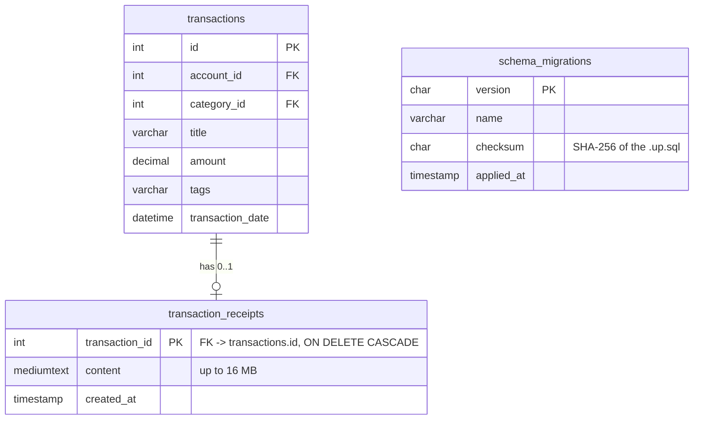

# Part A — Migration Report

**Migration:** single `schema.sql` → versioned database migrations, used first to move receipts out of `transactions.receipt_url` into a new `transaction_receipts` table.
**Commit:** `d02795f`. Supplementary configuration migration: `51634b9`, `8930c8e`.

## 1. Before state

- The whole schema lived in one file, `Backend/Database/schema.sql`. On startup the server ran it with `CREATE TABLE IF NOT EXISTS`. That works for an empty database but **cannot change an existing table**. There was no record of which schema version a database had.
- `transactions.receipt_url` was `VARCHAR(500)`. The Flutter app attaches receipts as base64 data URLs (`data:image/jpeg;base64,…`, typically 50 KB–2 MB) from `scan_screen.dart`. MySQL runs in strict mode, so every such insert failed:

  ```
  500 {"error":{"message":"Data too long for column 'receipt_url' at row 1","code":"ER_DATA_TOO_LONG"}}
  ```
  (captured from the Assignment 01 server in `evidence/regression-baseline.txt`, test ST-12). None of the 12 transactions in the production dump has a receipt, which is consistent with the feature never having worked.

## 2. Target state



- `Backend/Database/migrations/NNN_name.up.sql` (plus an optional `.down.sql`), applied in order by `src/database/migrator.js` and recorded in `schema_migrations`.
- **001_baseline_schema**: the Assignment 01 schema, unchanged. Because it uses `IF NOT EXISTS`, an existing Assignment 01 database adopts it as a no-op.
- **002_transaction_receipts**: creates `transaction_receipts`, copies every existing receipt into it, then drops `transactions.receipt_url`.
- **API compatibility:** the repository joins the table back in as `receipt_url`, so the JSON the app receives is unchanged.

## 3. Why

1. To fix a broken feature: receipt attachment (defect D1).
2. Schema changes need to be repeatable, ordered and auditable, and `CREATE IF NOT EXISTS` cannot provide that.
3. Large blobs in their own table keep the `transactions` rows small, so aggregate queries and indexes don't scan megabytes of image data.

## 4. Procedure (repeatable)

```bash
cd Backend
mysqldump expensemate_db > backup_$(date +%F).sql     # 1. backup (DDL is not transactional in MySQL)
npm run migrate:status                                 # 2. shows 001, 002 PENDING
node scripts/verify-migration.js snapshot before.json  # 3. fingerprint every row
npm run migrate                                        # 4. apply 001 (no-op) and 002
node scripts/verify-migration.js verify before.json    # 5. compare: counts + per-row SHA-256
npm run migrate:down                                   # (rollback, only if needed)
```

The server also applies pending migrations on startup when `AUTO_INIT_DB=true`. The runner:

- takes a MySQL named lock (`GET_LOCK`), so two servers can't migrate at the same time;
- refuses to run if an applied migration file was edited afterwards (checksum mismatch);
- refuses to roll back a migration that has no `.down.sql`.

## 5. Verification

| Evidence | Result |
|---|---|
| Rehearsal on a copy of the **production dump** in a throwaway MySQL ([evidence/migration-rehearsal.txt](evidence/migration-rehearsal.txt)) | users 3/3, accounts 15/15, categories 44/44, transactions 12/12: **0 missing, 0 changed**; second run is a no-op |
| Integration test: Assignment 01-style data **with** a receipt → migrate → verify | PASS; receipt copied byte-for-byte, old column dropped |
| Integration test: 200 KB receipt on old vs new schema | Old: `ER_DATA_TOO_LONG`; new: stored in full |
| Integration test: rollback, then re-apply | PASS |
| Integration test: edited applied migration | Refused (checksum mismatch) |
| System test ST-12 against both versions | Assignment 01: **500**; Assignment 02: **201**, receipt returned unchanged |

The verifier stores only row counts and SHA-256 fingerprints, so its output contains no personal data.

## 6. Risks and compatibility issues

| Risk | Mitigation |
|---|---|
| MySQL commits each DDL statement immediately, so a failure halfway through 002 cannot be rolled back automatically | Back up first; each step is small; the rehearsal on a production copy passed |
| Rollback (`002 down`) restores `VARCHAR(500)`, so receipts over 500 characters saved after the migration are **lost** | Documented in the `.down.sql` header; take a backup before any rollback |
| List endpoints still return full receipt data for every transaction (large payloads) | Kept on purpose for API compatibility; future work: return a `has_receipt` flag and fetch on demand |
| Tests use MySQL 8.0.31 while production runs 8.0.44 (8.0.31 is the newest build that runs on the team's macOS 12) | Same 8.0 series; only standard DDL is used |
| **Not yet run on the production server** | Run the procedure above during a quiet period, after a backup |

## 7. Supplementary migration — configuration and secrets out of source code

**Before:**
- The real `Backend/.env` (DB root password, JWT secret, SMTP password) and a production database dump were committed to git.
- A malformed `.gitignore` line meant `.env` was never ignored.
- The Flutter app hard-coded `http://213.136.94.160:5000/api`.

**After:**
- `.env` and dumps are untracked and ignored; `.env.example` holds placeholders only.
- The app reads `--dart-define=API_BASE_URL=…` at build time and warns at startup when it uses plain HTTP to a remote host.

**Remaining risk:** the old secrets are still in git history and must be rotated on the server.
