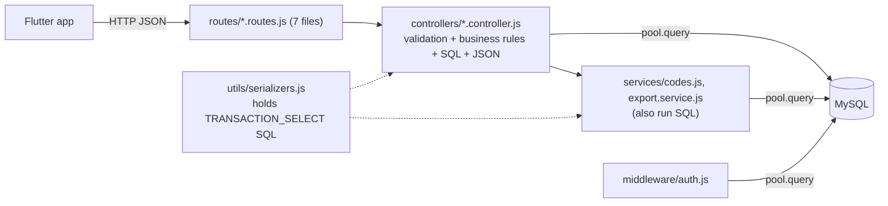
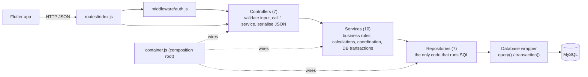
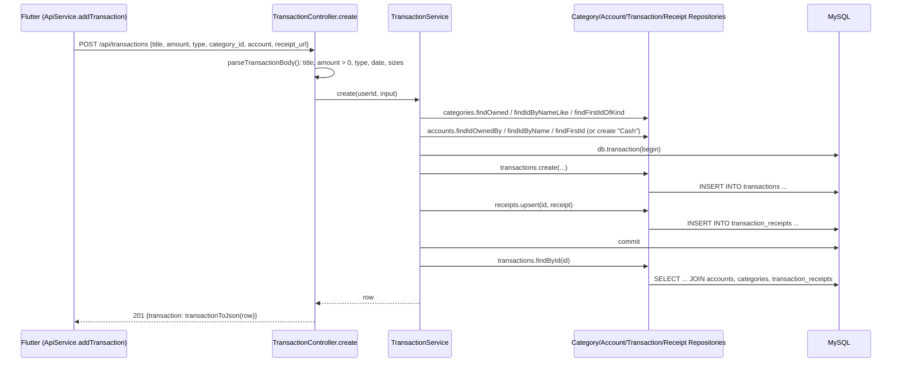

# Part B — Refactoring Report

**Target architecture:** Controller → Services → Repository → Database (no MVC).
**Commits:** `52d3fd8` (layering), `7b3071e` (table-driven profile update).
**Scope:** all 7 backend modules: auth, users, accounts, categories, transactions, budgets, overview/analytics. The two features the assignment asks for, **Add Transaction (Add Expense)** and **Monthly Budget Summary**, are traced below.

## 1. Before (Assignment 01)

Problems found in the code review:

- **Every controller ran SQL** through a global `pool`. In total, 11 files outside a data layer executed SQL (measured; see report 05).
- **Business rules were buried in controllers and SQL.** For example:
  - budget carry-forward was a correlated sub-query in `budget.controller.js`;
  - account balance was a SQL expression;
  - category/account resolution was an 85-line function (`parseTransactionBody`, cyclomatic complexity **27**) inside the transaction controller.
- **The same rule was implemented twice and inconsistently.** The dashboard's `total_budget` used its own query that summed *every* historical limit instead of applying carry-forward: defect **D2**, which reported 650 instead of 450.
- **Nothing could be tested in isolation.** The pool was created when the module was imported, so no business rule could be tested without a live database. There were 0 tests.

## 2. After (Assignment 02)

| Layer | Folder | Responsibility | May depend on |
|---|---|---|---|
| Controller | `src/controllers/` | Read `req`, validate basic input (`Validator`), call one service method, map the result to JSON (`serializers.js`) | Services |
| Service | `src/services/` | Business rules: balance = opening + income − expense; budget carry-forward; category/account resolution; OTP rules; currency conversion; analytics percentages and trend buckets. Opens DB transactions that span several repositories | Repositories (injected) |
| Repository | `src/repositories/` | Parameterised SQL only; returns raw rows and totals; no calculations | `Database` |
| Database | `src/database/database.js`, `config/db.js`, MySQL | Connection pool, `transaction(work)`, schema via migrations | — |

**The dependency direction is enforced automatically.** `tests/unit/architecture.test.js` reads every `require()` in `src/` and fails if:
- a controller imports a repository or the database;
- a service imports the database or a controller;
- SQL appears outside the repositories.

## 3. Feature 1 traced — Add Transaction (`POST /api/transactions`)

## 4. Feature 2 traced — Monthly Budget Summary (`GET /api/budgets?month=YYYY-MM`)

1. `BudgetController.list` parses `month` and calls `BudgetService.monthlySummary(userId, monthStart)`.
2. The service makes three repository calls in parallel:
   - `CategoryRepository.listExpenseCategories`
   - `BudgetRepository.listLimitsUpTo(month)`: raw rows, no rule applied
   - `TransactionRepository.expenseTotalsByCategory(month)`
3. The service applies the **carry-forward rule** in plain JavaScript (`effectiveLimits()`: the latest limit on or before the month wins) and joins in the spending figures.
4. The dashboard (`AnalyticsService.overview`) now calls `BudgetService.totalBudgetForMonth`, which reuses the **same** rule. This fixed defect D2.

Before, both rules were SQL fragments in two different controllers. Now the rule exists once and is unit-tested without a database (`tests/unit/budget.service.test.js`).

## 5. Code-quality improvements (measured; details in report 05)

1. **Separation of dependencies:** files outside the data layer that run SQL went from **11 to 0**, enforced by a test.
2. **Lower complexity:**
   - average cyclomatic complexity per function: **3.80 → 2.19**
   - maximum: **27 → 12**
   - functions above 10: **6 → 1**
   - non-blank lines in controllers: **866 → 355**
3. **Testability:** services receive their repositories through the constructor, and `container.js` lets tests inject a pool and a fake mailer. Backend tests went from **0 to 69**, with **90.8%** line coverage.
4. **One place per rule:**
   - JSON format in `serializers.js`;
   - error codes as typed errors (`NotFoundError`, `ConflictError`, …);
   - routes in one table instead of 7 files.
5. **Consistent writes:** registration (user + 5 accounts + 13 categories), currency conversion, and transaction + receipt are each one DB transaction coordinated by a service.

## 6. Keeping the UI usable

- **The API contract is unchanged.** The same 15 HTTP system tests pass against Assignment 01 (except the 3 defect tests) and Assignment 02. See [04_Test_Report.md](04_Test_Report.md).
- **No Flutter screen was modified** for the refactoring.

## 7. Trade-offs

- **More files and code.** There are 43 source files instead of 28, and about 52% more non-blank lines (comments and module boundaries included). Navigating takes one extra hop per layer; in return each file has one job.
- **Some queries became two calls.** For example, the budget summary now runs three simple queries instead of one correlated query. At the app's data sizes this is negligible, and the rule became testable.
